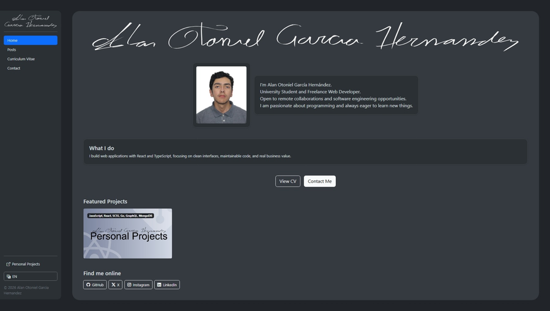
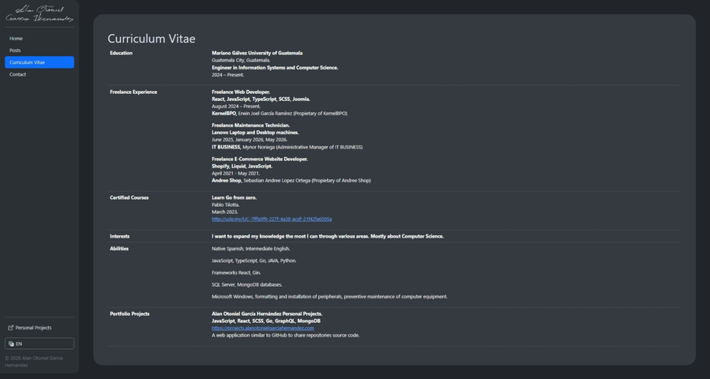

<div align="center">
  

  # Personal Website

  **Personal website to present my work, experience, and contact information.**  
  **Sitio web personal para presentar mi trabajo, experiencia e información de contacto.**

  [  ]( https://alanotonielgarciahernandez.com )
  [  ]( https://www.typescriptlang.org/ )
  [  ]( https://react.dev/ )
  [  ]( https://opensource.org/licenses/MIT )
</div>

---

## Demo / Demostración

**Live / En vivo:** [ https://www.alanotonielgarciahernandez.com ]( https://alanotonielgarciahernandez.com )

<!-- Add screenshots -->



## What it does / Qué hace

- Home page with a short introduction.  
  *Página de inicio con una introducción breve.*

- Posts section with personal articles.  
  *Sección de publicaciones con artículos personales.*

- Curriculum Vitae page (education, experience, projects, and courses).  
  *Página de Curriculum Vitae (educación, experiencia, proyectos y cursos).*

- Contact page with availability and preferred topics.  
  *Página de contacto con disponibilidad y temas de interés.*

Content is loaded from localized JSON files for easier updates.  
*El contenido se carga desde archivos JSON localizados para facilitar las actualizaciones.*

## Tech Stack / Tecnologías

- **Language / Lenguaje:** TypeScript
- **Framework:** React + Vite
- **Routing:** React Router
- **Styling:** Bootstrap + React-Bootstrap
- **Package Manager:** Yarn

## How to run it / Cómo correrlo

### Requirements / Requisitos

- Node.js 18+
- Yarn

### Steps / Pasos

```bash
git clone https://github.com/alanotonielgarciahernandez/alan-otoniel-garcia-hernandez-personal-website.git
cd alan-otoniel-garcia-hernandez-personal-website
yarn install
yarn dev